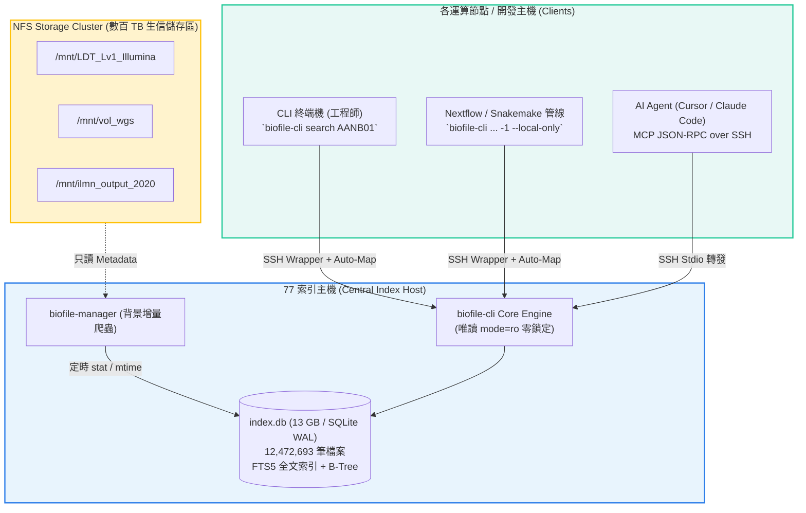

# biofile-cli (ACTGenomics)

> ⚡ **專為數百 TB 生信 NFS 叢集打造的秒級檔案檢索工具與 MCP Server**  
> 一處維護索引（77 主機），全網各主機與 AI Agent 毫秒級免硬碟搜尋。

---

## 📌 目錄 (Table of Contents)
1. [架構總覽 (Architecture)](#-架構總覽-architecture)
2. [效能評測對比 (Benchmarks)](#-效能評測對比-benchmarks)
3. [安裝指南 (Installation)](#-安裝指南-installation)
4. [CLI 使用範例 (CLI Usage)](#-cli-使用範例-cli-usage)
5. [AI Agent MCP 整合 (Agent MCP Setup)](#-ai-agent-mcp-整合-agent-mcp-setup)
6. [跨主機 NFS 自動路徑映射 (Path Mapping)](#-跨主機-nfs-自動路徑映射-path-mapping)
7. [生信管線整合 (Nextflow & Snakemake)](#-生信管線整合-nextflow--snakemake)
8. [常見問題 (FAQ)](#-常見問題-faq)

---

## 🏗️ 架構總覽 (Architecture)

在傳統環境中，在跨十幾個 NFS 掛載點、數百 TB 儲存池下執行 `find` 或 `fd` 往往需數小時，並使 NAS IOPS 瀕臨飽和崩潰。  
`biofile-cli` 透過讀取 77 主機上 `biofile-manager` 維護的 SQLite WAL + FTS5 集中式索引庫，達成 **全域 1,247 萬筆檔案在毫秒內精準定位**。



---

## ⚡ 效能評測對比 (Benchmarks)

- **測試規模**：**12,472,693 筆檔案**、**1,164,148 個目錄**（涵蓋 15 個核心 NFS Shares）。
- **完整 Excel 報告**：[benchmark_comparison.xlsx](./benchmark_comparison.xlsx)

| 搜尋情境 | 傳統 `find` (POSIX) | 現代 `fd` (Rust 多執行緒) | `biofile-cli` (SQLite FTS5) | 速度勝出關鍵 |
| :--- | :--- | :--- | :--- | :--- |
| **生信條碼全域檢索**<br>`AANB01_513` (跨 15 個 NFS Shares) | 數十分鐘至 2 小時<br>(極耗 NAS IOPS) | > 15 ~ 30 秒<br>(需逐一發起網路走訪) | **658 ms** ⚡ | **biofile-cli 完勝**<br>FTS5 樣品條碼反向索引，秒級定位 |
| **全庫萬用字元檢索**<br>`AANB01*` (跨 1,247 萬筆紀錄) | > 30 分鐘 | 需指定單一 Share，無法單次跨庫 | **81 ms** ⚡ | **biofile-cli 完勝**<br>單一集中索引，跨 Share 聚合零延遲 |
| **指定副檔名與大小篩選**<br>`--ext bam --min-size 50M` | 10 ~ 20 分鐘 | 143 ms<br>(限單一已快取目錄) | **89 ms** ⚡ | **biofile-cli 領先**<br>B-Tree 複合索引 `(root, ext)` 與 size 直接過濾 |
| **查無檔案 / 深度走訪 (Worst-case Miss)**<br>查找不存在的樣品號 | 數小時直到走訪完畢 | 數十秒至數分鐘<br>(必須完整遍歷整棵樹) | **< 10 ms** ⚡ | **biofile-cli 完勝**<br>索引查無即刻回傳，絕不敲擊 NFS |
| **虛擬目錄展開 (Virtual `ls`)**<br>列出某子目錄所有檔案 | 5 ~ 15 秒 | 10 ~ 50 ms | **8 ms** ⚡ | **biofile-cli 領先**<br>直接依 `parent` 欄位拉取，完全不敲擊 NFS |

---

## 🚀 安裝指南 (Installation)

### 1. 在其他工作主機端 (Client Machines / 運算節點)
客戶端**完全不需要安裝資料庫、不需要複製 13GB 檔案、甚至不需要掛載全部 NFS**！  
執行專案隨附的一鍵安裝腳本，會自動比對本機 NFS 來源並產生智慧 Wrapper：

```bash
git clone git@github.com:ACTGenomics/biofile-cli.git
cd biofile-cli
./install_remote.sh
```

### 2. 在 77 索引主機端 (Server Local Install)
```bash
cp biofile_cli.py ~/.local/bin/biofile-cli
chmod +x ~/.local/bin/biofile-cli
```

---

## 💻 CLI 使用範例 (CLI Usage)

```bash
# 1. 樣品條碼一鍵查找 (列出該檢體所有 FASTQ, BAM, VCF, CNV)
biofile-cli sample AANB01_513

# 2. 多條件搜尋 (關鍵字、副檔名、檔案大小限制)
biofile-cli search "AANB01*" --ext fastq.gz --min-size 10M

# 3. 管線專用純路徑輸出 (方便接 xargs 或 piping)
biofile-cli search AANB01 --ext bam -1 | xargs -n 1 samtools quickcheck

# 4. 只取本機節點真實掛載的檔案 (過濾未掛載磁區，保護管線不中斷)
biofile-cli search AANB01 --ext bam -1 --local-only

# 5. 虛擬資料夾展開 (毫秒級展開目錄層級，完全不敲擊 NFS)
biofile-cli ls /mnt/ilmn_output_2020/drugv6_verification_result

# 6. 查看索引庫健康狀態與納管的 NFS 清單
biofile-cli status
```

---

## 🤖 AI Agent MCP 整合 (Agent MCP Setup)

支援在 Cursor、Claude Code、Windsurf 或自建 Agent 中直接秒查數百 TB NFS。  
在 Agent 的設定檔（如 `.mcp.json` 或 `claude_desktop_config.json`）加入：

### 遠端主機 Agent（透過 SSH 無縫調用 77）
```json
{
  "mcpServers": {
    "nfs-search": {
      "command": "ssh",
      "args": ["-T", "cgh2@192.168.5.77", "biofile-cli", "mcp"]
    }
  }
}
```

### 本機 Agent（直接本機執行）
```json
{
  "mcpServers": {
    "nfs-search": {
      "command": "biofile-cli",
      "args": ["mcp"]
    }
  }
}
```

> 📖 **詳細 Agent 調用時機與參數指引**，請參閱專屬文檔：[AGENTS.md](./AGENTS.md)。

---

## 🔄 跨主機 NFS 自動路徑映射 (Path Mapping)

### 痛點與解法
77 主機上的路徑為 `/mnt/LDT_Lv1_Illumina`，但運算節點可能掛載在 `/storage/illumina_lv1`。  
執行 `./install_remote.sh` 時，系統會**自動比對兩台機器的 `/proc/self/mountinfo` 底層 Volume**，自動生成 `~/.biofile_map.json`：

```
[77 主機資料庫原始路徑]
/mnt/LDT_Lv1_Illumina/ProjectA/sample.bam
                 │
                 ▼ (客戶端 biofile-cli 自動依 ~/.biofile_map.json 轉換)
[轉換成客戶端主機的有效本機路徑]
/storage/illumina_lv1/ProjectA/sample.bam  <── 本地管線與 Agent 直接可開！
```

### 本地 NFS 掛載變動更新 (`--sync-mounts`)
當你的主機掛載名稱調整或新掛載了磁區，只需執行：
```bash
biofile-cli --sync-mounts
```
Wrapper 會即時自動重新比對並更新映射，無需重新安裝！

---

## 🧬 生信管線整合 (Nextflow & Snakemake)

### Nextflow 範例
```groovy
// main.nf
channel
    .fromPath(
        "biofile-cli search "${params.sample_id}*" --ext fastq.gz -1 --local-only"
        .execute().text.readLines()
    )
    .filter { it =~ /_R1/ }
    .map { file -> tuple(params.sample_id, file, file.toString().replaceAll('_R1', '_R2')) }
    .set { fastq_ch }
```

### Snakemake 範例
```python
# Snakefile
def get_sample_bam(wildcards):
    cmd = ["biofile-cli", "sample", wildcards.sample, "--ext", "bam", "-1", "--local-only"]
    return subprocess.check_output(cmd).decode().strip().splitlines()[0]

rule samtools_qc:
    input: bam = get_sample_bam
    output: "results/{sample}.flagstat.txt"
    shell: "samtools flagstat {input.bam} > {output}"
```

---

## ❓ 常見問題 (FAQ)

#### Q1: 在客戶端下指令需要手動指定路徑轉換參數嗎？
**完全不需要**。Wrapper 會自動將輸出路徑轉換成本機路徑；若你在指令輸入本機路徑（例如 `--root /storage/illumina_lv1`），Wrapper 也會自動反向轉回 77 格式查詢，全程雙向透明。

#### Q2: 77 主機有該檔案，但我這台客戶端「未掛載該磁區」，會發生什麼事？
1. **終端機表格**：行尾會顯示 `[⚠️ NOT MOUNTED ON THIS HOST]` 清楚提示。
2. **AI Agent / JSON**：回傳 `"mounted_on_client": false`，防止 Agent 在本地誤開檔案。
3. **管線防呆**：下指令時帶上 `--local-only`，自動略過未掛載磁區，確保 Pipeline 不中斷。

#### Q3: 什麼是「虛擬目錄」？
虛擬目錄代表使用者在下 `biofile-cli ls` 時，**完全不發送任何網路請求去敲擊 NFS 硬碟**，而是直接由本地資料庫快照在 8 毫秒內瞬間展開目錄，即使該 NFS 暫時網路斷線依然能秒看目錄結構。
