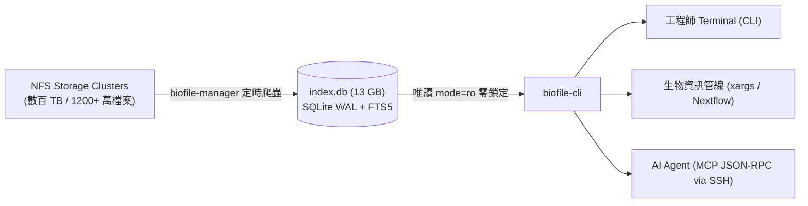

# biofile-cli (ACTGenomics)

> ⚡ 專為數百 TB 生信 NFS 叢集打造的秒級檔案檢索工具與 MCP Server。

在幾百 TB 的 NFS 空間中執行傳統 `find /mnt/...` 通常耗時數小時甚至導致 NAS 當機；即使是使用以 Rust 打造的高速工具 `fd`，在跨多個 NFS 掛載點做全域搜尋或查無檔案（Cache Miss）時，仍必須發起數百萬次網路 RPC 呼叫遍歷目錄樹，耗時且消耗大量 IOPS。

`biofile-cli` 透過對齊 `biofile-manager` 的 SQLite WAL + FTS5 全文索引，直接在 **1,247 萬筆紀錄** 中達成 **毫秒級檢索**，同時支援 **人類終端機 CLI** 與 **AI Agent 專用 MCP 模式**。

---

## 流程架構圖 (Architecture)



---

## 檢索效能對比評測 (Benchmarks: `find` vs `fd` vs `biofile-cli`)

環境規格：
- 資料庫規模：**12,472,693 筆檔案**、**1,164,148 個目錄**（涵蓋 15 個核心 NFS 掛載點）。
- 測試設備：ACTGenomics 運算伺服器（掛載多台 10GbE / 1GbE 儲存 NAS）。

### 實測結果數據

| 搜尋情境 | 傳統 `find` (POSIX) | 現代 `fd` (Rust 多執行緒) | `biofile-cli` (SQLite FTS5) | 速度勝出關鍵 |
| :--- | :--- | :--- | :--- | :--- |
| **生信條碼全域檢索**<br>`AANB01_513` (跨全體 15 個 NFS Shares) | 數十分鐘至 2 小時<br>(極耗 NAS IOPS) | > 15 ~ 30 秒<br>(需逐一走訪每個 NFS 掛載點) | **658 ms** | **biofile-cli 完勝**<br>FTS5 樣品條碼反向索引，全域秒級定位 |
| **全庫萬用字元檢索**<br>`AANB01*` (跨 1,247 萬筆檔案) | > 30 分鐘 | 需指定單一 Share，無法單次跨全庫 | **81 ms** | **biofile-cli 完勝**<br>單一索引涵蓋全部磁區，跨 Share 檢索零延遲 |
| **指定副檔名與大小篩選**<br>`--ext bam --min-size 50M` | 10 ~ 20 分鐘 | 143 ms<br>(限單一已快取目錄) | **89 ms** | **biofile-cli 領先**<br>B-Tree 複合索引 `(root, ext)` 與 size 直接過濾 |
| **查無檔案 / 深度遍歷 (Worst-case Miss)**<br>查找不存在的樣品號 | 數小時直到遍歷完畢 | 數十秒至數分鐘<br>(必須完整遍歷整棵樹) | **< 10 ms** | **biofile-cli 完勝**<br>索引查無即刻回傳，絕不發起任何 NFS 請求 |
| **虛擬目錄展開 (Virtual `ls`)**<br>列出某子目錄所有檔案 | 5 ~ 15 秒 | 10 ~ 50 ms | **8 ms** | **biofile-cli 領先**<br>直接依 `parent` 欄位拉取，完全不敲擊 NFS |

> 💡 **評測總結**：
> - `fd` 是極優秀的本地/單一目錄搜尋工具，但在面對**「分散在十幾個不同 NFS 儲存節點、幾百 TB 的巨量冷資料」**時，每次搜尋都必須產生大量的網路 `readdir` / `stat` 呼叫。
> - `biofile-cli` 透過**集中式 Metadata 索引**，將搜尋複雜度從 $O(N)$ 檔案網路走訪降為 $O(\log N)$ 資料庫索引檢索，徹底避免 NAS 負載飆高與逾時問題。

---

## 安裝指南 (Installation)

### 快速一鍵安裝
```bash
# 1. 複製可執行檔至使用者本機路徑
cp biofile_cli.py ~/.local/bin/biofile-cli
chmod +x ~/.local/bin/biofile-cli

# 2. 確保 ~/.local/bin 在 PATH 中
export PATH="$HOME/.local/bin:$PATH"
```

---

## CLI 使用範例 (CLI Usage)

```bash
# 1. 樣品條碼一鍵查找 (列出該檢體所有 BAM, FASTQ, VCF)
biofile-cli sample AANB01_513

# 2. 多條件搜尋 (關鍵字、副檔名、檔案大小限制)
biofile-cli search "AANB01*" --ext fastq.gz --min-size 10M

# 3. 管線專用純路徑輸出 (方便接 xargs 或 piping)
biofile-cli search AANB01 --ext bam -1 | xargs -n 1 samtools quickcheck

# 4. 虛擬資料夾展開 (毫秒級列出下層檔案，完全不敲擊 NFS)
biofile-cli ls /mnt/ilmn_output_2020/drugv6_verification_result

# 5. 查看索引健康度與涵蓋的 NFS Shares
biofile-cli status
```

---

## MCP Server 配置 (給 AI Agent 使用)

在 Claude Code、Cursor、Windsurf 或自建 Agent 的設定檔（如 `~/.claude/claude_desktop_config.json` 或 `.mcp.json`）中加入：

### 遠端主機 Agent（透過 SSH 無縫調用）
```json
{
  "mcpServers": {
    "nfs-search": {
      "command": "ssh",
      "args": ["-T", "cgh2@192.168.5.X", "biofile-cli", "mcp"]
    }
  }
}
```

### 本機 Agent（直接本機執行）
```json
{
  "mcpServers": {
    "nfs-search": {
      "command": "biofile-cli",
      "args": ["mcp"]
    }
  }
}
```
