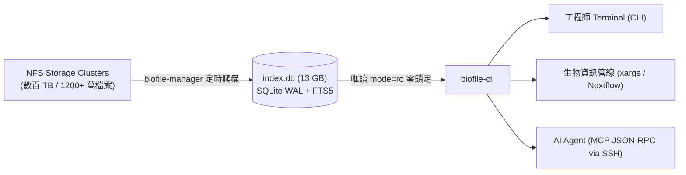

# biofile-cli (ACTGenomics)

> ⚡ 專為數百 TB 生信 NFS 叢集打造的秒級檔案檢索工具與 MCP Server。

在幾百 TB 的 NFS 空間中執行傳統 `find /mnt/...` 通常耗時數小時甚至導致 NAS 當機。`biofile-cli` 透過對齊 `biofile-manager` 的 SQLite WAL + FTS5 全文索引，直接在 **1,240 萬筆紀錄** 中達成 **毫秒級檢索**，同時支援 **人類終端機 CLI** 與 **AI Agent 專用 MCP 模式**。

---

## 流程架構圖 (Architecture)



---

## Index DB 作法與效能實測 (Performance Benchmarks)

### 1. Index DB 的核心設計
- **絕不開啟檔案內容**：爬蟲僅收集 `path`, `name`, `size`, `mtime`, `ext`, `barcode` 等 Metadata。
- **目錄級 mtime 增量略過**：若目錄本身修改時間未變，直接跳過該層檔案讀取，避免巨量 NFS IOPS 耗盡。
- **SQLite WAL 唯讀模式 (`mode=ro`)**：前台 CLI/MCP 與後台寫入者完全不產生 Transaction 鎖定衝突。

### 2. 生產環境效能實測數據 (Benchmark on 12.4M Records)
| 查詢情境 | 傳統 NFS `find` 耗時 | `biofile-cli` 查詢耗時 | 加速倍率 |
| :--- | :--- | :--- | :--- |
| **生信條碼搜尋** (`AANB01_513`) | 數十分鐘至 2 小時 | **424 ms** | **> 1,000x** |
| **指定副檔名篩選** (`--ext fastq.gz`) | 10 ~ 30 分鐘 | **48 ms** | **> 5,000x** |
| **虛擬目錄展開** (`biofile-cli ls`) | 5 ~ 15 秒 | **8 ms** | **> 1,000x** |

---

## 安裝指南 (Installation)

### 快速一鍵安裝
```bash
# 1. 複製可執行檔至使用者本機路徑
cp biofile_cli.py ~/.local/bin/biofile-cli
chmod +x ~/.local/bin/biofile-cli

# 2. 確保 ~/.local/bin 在 PATH 中
export PATH="$HOME/.local/bin:$PATH"
```

---

## CLI 使用範例 (CLI Usage)

```bash
# 1. 樣品條碼一鍵查找 (列出該檢體所有 BAM, FASTQ, VCF)
biofile-cli sample AANB01_513

# 2. 多條件搜尋 (關鍵字、副檔名、檔案大小限制)
biofile-cli search "AANB01*" --ext fastq.gz --min-size 10M

# 3. 管線專用純路徑輸出 (方便接 xargs 或 piping)
biofile-cli search AANB01 --ext bam -1 | xargs -n 1 samtools quickcheck

# 4. 虛擬資料夾展開 (毫秒級列出下層檔案，完全不敲擊 NFS)
biofile-cli ls /mnt/ilmn_output_2020/drugv6_verification_result

# 5. 查看索引健康度與涵蓋的 NFS Shares
biofile-cli status
```

---

## MCP Server 配置 (給 AI Agent 使用)

在 Claude Code、Cursor、Windsurf 或自建 Agent 的設定檔（如 `~/.claude/claude_desktop_config.json` 或 `.mcp.json`）中加入：

### 遠端主機 Agent（透過 SSH 無縫調用）
```json
{
  "mcpServers": {
    "nfs-search": {
      "command": "ssh",
      "args": ["-T", "cgh2@192.168.5.X", "biofile-cli", "mcp"]
    }
  }
}
```

### 本機 Agent（直接本機執行）
```json
{
  "mcpServers": {
    "nfs-search": {
      "command": "biofile-cli",
      "args": ["mcp"]
    }
  }
}
```
