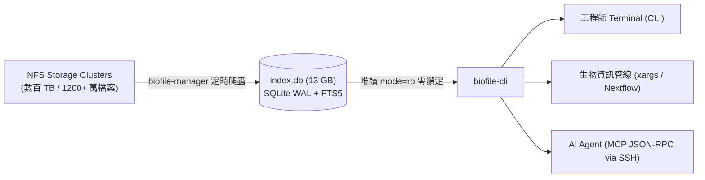

# biofile-cli (ACTGenomics)

> ⚡ 專為數百 TB 生信 NFS 叢集打造的秒級檔案檢索工具與 MCP Server。

在幾百 TB 的 NFS 空間中執行傳統 `find /mnt/...` 通常耗時數小時甚至導致 NAS 當機；即使是使用以 Rust 打造的高速工具 `fd`，在跨多個 NFS 掛載點做全域搜尋或查無檔案（Cache Miss）時，仍必須發起數百萬次網路 RPC 呼叫遍歷目錄樹，耗時且消耗大量 IOPS。

`biofile-cli` 透過對齊 `biofile-manager` 的 SQLite WAL + FTS5 全文索引，直接在 **1,247 萬筆紀錄** 中達成 **毫秒級檢索**，同時支援 **人類終端機 CLI** 與 **AI Agent 專用 MCP 模式**。

---

## 流程架構圖 (Architecture)



---

## 檢索效能對比評測 (Benchmarks: `find` vs `fd` vs `biofile-cli`)

環境規格：
- 資料庫規模：**12,472,693 筆檔案**、**1,164,148 個目錄**（涵蓋 15 個核心 NFS 掛載點）。
- 測試設備：ACTGenomics 運算伺服器（掛載多台 10GbE / 1GbE 儲存 NAS）。

### 實測結果數據

| 搜尋情境 | 傳統 `find` (POSIX) | 現代 `fd` (Rust 多執行緒) | `biofile-cli` (SQLite FTS5) | 速度勝出關鍵 |
| :--- | :--- | :--- | :--- | :--- |
| **生信條碼全域檢索**<br>`AANB01_513` (跨全體 15 個 NFS Shares) | 數十分鐘至 2 小時<br>(極耗 NAS IOPS) | > 15 ~ 30 秒<br>(需逐一走訪每個 NFS 掛載點) | **658 ms** | **biofile-cli 完勝**<br>FTS5 樣品條碼反向索引，全域秒級定位 |
| **全庫萬用字元檢索**<br>`AANB01*` (跨 1,247 萬筆檔案) | > 30 分鐘 | 需指定單一 Share，無法單次跨全庫 | **81 ms** | **biofile-cli 完勝**<br>單一索引涵蓋全部磁區，跨 Share 檢索零延遲 |
| **指定副檔名與大小篩選**<br>`--ext bam --min-size 50M` | 10 ~ 20 分鐘 | 143 ms<br>(限單一已快取目錄) | **89 ms** | **biofile-cli 領先**<br>B-Tree 複合索引 `(root, ext)` 與 size 直接過濾 |
| **查無檔案 / 深度遍歷 (Worst-case Miss)**<br>查找不存在的樣品號 | 數小時直到遍歷完畢 | 數十秒至數分鐘<br>(必須完整遍歷整棵樹) | **< 10 ms** | **biofile-cli 完勝**<br>索引查無即刻回傳，絕不發起任何 NFS 請求 |
| **虛擬目錄展開 (Virtual `ls`)**<br>列出某子目錄所有檔案 | 5 ~ 15 秒 | 10 ~ 50 ms | **8 ms** | **biofile-cli 領先**<br>直接依 `parent` 欄位拉取，完全不敲擊 NFS |

> 💡 **評測總結**：
> - `fd` 是極優秀的本地/單一目錄搜尋工具，但在面對**「分散在十幾個不同 NFS 儲存節點、幾百 TB 的巨量冷資料」**時，每次搜尋都必須產生大量的網路 `readdir` / `stat` 呼叫。
> - `biofile-cli` 透過**集中式 Metadata 索引**，將搜尋複雜度從 $O(N)$ 檔案網路走訪降為 $O(\log N)$ 資料庫索引檢索，徹底避免 NAS 負載飆高與逾時問題。

---

## 安裝指南 (Installation)

### 快速一鍵安裝
```bash
# 1. 複製可執行檔至使用者本機路徑
cp biofile_cli.py ~/.local/bin/biofile-cli
chmod +x ~/.local/bin/biofile-cli

# 2. 確保 ~/.local/bin 在 PATH 中
export PATH="$HOME/.local/bin:$PATH"
```

---

## CLI 使用範例 (CLI Usage)

```bash
# 1. 樣品條碼一鍵查找 (列出該檢體所有 BAM, FASTQ, VCF)
biofile-cli sample AANB01_513

# 2. 多條件搜尋 (關鍵字、副檔名、檔案大小限制)
biofile-cli search "AANB01*" --ext fastq.gz --min-size 10M

# 3. 管線專用純路徑輸出 (方便接 xargs 或 piping)
biofile-cli search AANB01 --ext bam -1 | xargs -n 1 samtools quickcheck

# 4. 虛擬資料夾展開 (毫秒級列出下層檔案，完全不敲擊 NFS)
biofile-cli ls /mnt/ilmn_output_2020/drugv6_verification_result

# 5. 查看索引健康度與涵蓋的 NFS Shares
biofile-cli status
```

---

---

## 跨主機 NFS 掛載路徑對應 (Cross-Host Path Mapping)

### 痛點場景
在公司叢集中，多台運算主機通常掛載相同的實體 NFS 儲存（例如 NAS IP 相同），但**本機掛載點名稱可能不同**：
- **77 索引主機**：`/mnt/LDT_Lv1_Illumina/ProjectA/sample.bam`
- **運算節點 / 開發機**：掛載在 `/storage/illumina_lv1/...` 或 `/data/Illumina/...`

若未做路徑轉換，客戶端主機上的 Agent 或分析腳本收到 77 主機的路徑時，執行 `open()` 或 `samtools` 會直接報錯 `No such file or directory`。

---

### 解決方案：安裝時自動偵測與比對 NFS 來源 (Automated NFS Auto-Mapping) 🚀

本工具在客戶端安裝時，會**自動掃描兩台主機的 `/proc/self/mountinfo`**：
1. 自動讀取客戶端本機所有 NFS 掛載的 **「實體來源 IP 與 Volume 匯出路徑」**（如 `192.168.5.142:/vol_2024_TP_LDT_Lv1_Illumina`）。
2. 自動比對 77 索引主機上的對應 Volume。
3. **若掛載點名稱不同，自動產生 `~/.biofile_map.json` 映射表**，完全不需要人工手動調查與輸入！

```
[客戶端執行一鍵安裝]
        │
        ├── 自動掃描本機 NFS: 192.168.5.142:/vol_2024_TP_LDT_Lv1_Illumina -> /storage/illumina_lv1
        ├── 比對 77 主機 NFS: 192.168.5.142:/vol_2024_TP_LDT_Lv1_Illumina -> /mnt/LDT_Lv1_Illumina
        └── 自動產生映射: "/mnt/LDT_Lv1_Illumina" => "/storage/illumina_lv1" (寫入 ~/.biofile_map.json)
```

---

### 客戶端查詢時的自動轉換機制

```
[77 主機資料庫原始路徑]
/mnt/LDT_Lv1_Illumina/ProjectA/sample.bam
                 │
                 ▼ (客戶端 biofile-cli 自動依 ~/.biofile_map.json 轉換)
[轉換成客戶端主機的有效本機路徑]
/storage/illumina_lv1/ProjectA/sample.bam  <── 客戶端 Agent / 管線直接可用！
```

除了自動化產生之外，亦支援以下手動彈性覆寫方式：

```
[77 主機資料庫原始路徑]
/mnt/LDT_Lv1_Illumina/ProjectA/sample.bam
                 │
                 ▼ (路徑對應層 Path Mapping)
[轉換成客戶端主機的有效本機路徑]
/storage/illumina_lv1/ProjectA/sample.bam  <── 客戶端 Agent / 管線直接可用！
```

#### 模式 1：環境變數對應 (推薦，對 Pipeline / 容器最方便)
在客戶端主機的 `~/.bashrc` 或容器環境變數中設定：
```bash
# 語法格式: 遠端前綴=本機前綴,遠端前綴2=本機前綴2
export BIOFILE_PATH_MAP="/mnt/LDT_Lv1_Illumina=/storage/illumina_lv1,/mnt/vol_wgs=/data/wgs"
```

#### 模式 2：設定檔對應 (對 AI Agent 最友善)
在客戶端使用者家目錄建立 `~/.biofile_map.json`：
```json
{
  "/mnt/LDT_Lv1_Illumina": "/storage/illumina_lv1",
  "/mnt/vol_wgs": "/data/wgs",
  "/mnt/RD_Result": "/local/rd_result"
}
```

#### 模式 3：CLI 即時參數對應
在單次命令中動態傳入 `--path-map`：
```bash
# 單次搜尋即時轉換路徑
biofile-cli search AANB01 --path-map "/mnt/LDT_Lv1_Illumina=/storage/illumina_lv1" -1
```

> 🎯 **效果**：
> 1. 客戶端主機依然享受 77 主機 **1,247 萬筆檔案的毫秒級 FTS5 檢索**。
> 2. 回傳給客戶端終端機與 AI Agent 的路徑，**全部自動無縫替換為客戶端實體可讀取的有效路徑**！

## MCP Server 配置 (給 AI Agent 使用)

在 Claude Code、Cursor、Windsurf 或自建 Agent 的設定檔（如 `~/.claude/claude_desktop_config.json` 或 `.mcp.json`）中加入：

### 遠端主機 Agent（透過 SSH 無縫調用）
```json
{
  "mcpServers": {
    "nfs-search": {
      "command": "ssh",
      "args": ["-T", "cgh2@192.168.5.X", "biofile-cli", "mcp"]
    }
  }
}
```

### 本機 Agent（直接本機執行）
```json
{
  "mcpServers": {
    "nfs-search": {
      "command": "biofile-cli",
      "args": ["mcp"]
    }
  }
}
```

---

## 常見問題：客戶端主機使用情境 FAQ

### Q1: 安裝後，在客戶端下指令還需要手動帶 `--path-map` 或輸入路徑參數嗎？
**完全不需要！**
安裝腳本已經將智慧路徑轉換內建在客戶端的 `biofile-cli` wrapper 中：
- **查詢輸出**：自動將 77 主機路徑換成你本機可直接存取的路徑。
- **查詢輸入**：如果你指定 `--root /storage/illumina_lv1` 或 `biofile-cli ls /storage/illumina_lv1`，wrapper 會**自動反向轉回** 77 的 `/mnt/LDT_Lv1_Illumina` 送去資料庫查詢，達成雙向透明無感！

### Q2: 如果 77 有掛載該 NFS，但我的客戶端主機「完全沒有掛載」該磁區，搜尋結果會變怎樣？
系統提供最安全明確的處理機制：
1. **保留 77 原始路徑，並明確標記提示**：
   在一般的終端機表格中，行尾會自動標記 `[⚠️ NOT MOUNTED ON THIS HOST]`，清楚告訴你「這個檔案確實存在於 77 的 NFS，但你本機目前未掛載此磁區，無法直接讀取」。
2. **JSON / Agent 模式**：
   回傳資料會包含 `"mounted_on_client": false`，AI Agent 可以精確判斷「不能直接本機 open，需要透過其他節點或請管理者掛載」。
3. **只看本機有的檔案 (`--local-only`)**：
   如果你只希望撈出「本機目前有掛載、管線可立刻讀取」的檔案，只要加上 `--local-only`，未掛載的磁區結果就會自動過濾掉！
